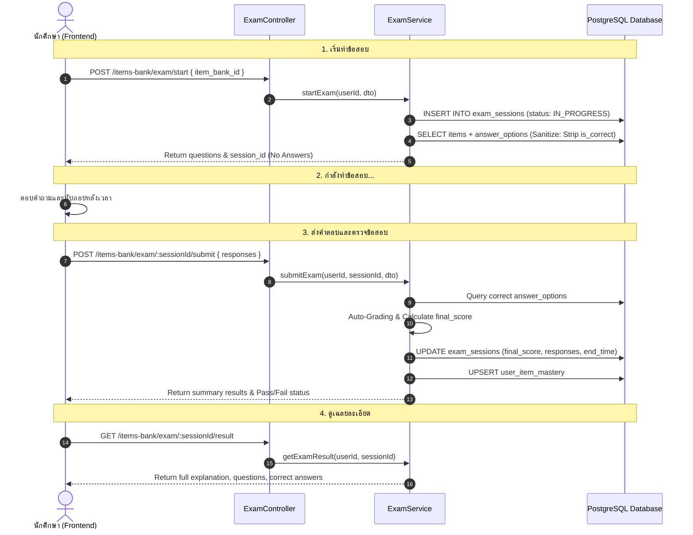

# เอกสารโครงสร้างและการทำงานของ Items-Bank Module
## โครงการ: Pharmacy Exam Adaptive Testing & Learning Management Platform
**Path**: `pharmacy_backend/src/items-bank/`  
**Framework**: NestJS, TypeORM, PostgreSQL  

---

# สารบัญ (Table of Contents)
1. [ภาพรวมของโมดูล (Module Overview)](#1-ภาพรวมของโมดูล-module-overview)
2. [โครงสร้างไดเรกทอรีและไฟล์ (Directory Structure)](#2-โครงสร้างไดเรกทอรีและไฟล์-directory-structure)
3. [ตารางฐานข้อมูลและ Entity (Database Entities)](#3-ตารางฐานข้อมูลและ-entity-database-entities)
4. [ตัวควบคุมและ API Endpoints (Controllers Layer)](#4-ตัวควบคุมและ-api-endpoints-controllers-layer)
   - 4.1 [ItemsBankController (Admin / Management)](#41-itemsbankcontroller-admin--management)
   - 4.2 [ExamController (Student Exam Engine)](#42-examcontroller-student-exam-engine)
5. [ส่วนประมวลผลตรรกะ (Services Layer)](#5-ส่วนประมวลผลตรรกะ-services-layer)
   - 5.1 [ItemsBankService (Core CRUD & Management)](#51-itemsbankservice)
   - 5.2 [ExamService (Exam Lifecycle & Grading)](#52-examservice)
   - 5.3 [IrtManagementService (Psychometrics & 3PL Model)](#53-irtmanagementservice)
   - 5.4 [ItemsBankImportService (Excel & Bulk Import)](#54-itemsbankimportservice)
6. [Data Transfer Objects (DTO Layer)](#6-data-transfer-objects-dto-layer)
7. [วงจรการทำงานของระบบสอบ (Exam Lifecycle Flow)](#7-วงจรการทำงานของระบบสอบ-exam-lifecycle-flow)

---

# 1. ภาพรวมของโมดูล (Module Overview)

`ItemsBankModule` เป็นหัวใจหลักในการจัดการเนื้อหาข้อสอบและการประเมินผลของระบบ โดยครอบคลุม 4 ฟังก์ชันหลัก:
- **Item & Scenario Management:** จัดเก็บข้อสอบเดี่ยว, โจทย์ร่วมสถานการณ์ทางคลินิก (Case Vignettes), ตัวเลือกคำตอบ และการเชื่อมโยง Taxonomy วิชา
- **Exam Sets & Sequence:** รวมข้อสอบเป็นชุด (Item Bank), จัดเรียงลำดับข้อสอบ (`sequence_order`), ตั้งเวลา และกำหนดเกณฑ์ผ่าน
- **Standard Exam Engine:** ระบบเริ่มสอบ, ควบคุมเวลา, ตรวจคำตอบอัตโนมัติ (Auto-Grading), ซ่อนเฉลยป้องกันการทุจริต และบันทึกประวัติ
- **IRT Psychometrics (3PL Model):** การคำนวณและวิเคราะห์พารามิเตอร์ข้อสอบทางสถิติ ($a, b, c$), กราฟโค้งลักษณะข้อสอบ (ICC) และฟังก์ชันสารสนเทศ (TIF)

---

# 2. โครงสร้างไดเรกทอรีและไฟล์ (Directory Structure)

```
pharmacy_backend/src/items-bank/
├── dto/
│   ├── add-questions-to-situation.dto.ts
│   ├── answer_options.dto.ts
│   ├── create-bulk-questions.dto.ts
│   ├── create-items-bank.dto.ts
│   ├── create-items.dto.ts
│   ├── create-situation.dto.ts
│   ├── exam-history-filter.dto.ts
│   ├── exam.dto.ts
│   ├── reorder-items.dto.ts
│   └── update-items-bank.dto.ts
├── entities/
│   ├── answer_options.entity.ts
│   ├── exam-session.entity.ts
│   ├── item_bank_category.entity.ts
│   ├── item_bank_items.entity.ts
│   ├── item_situations.entity.ts
│   ├── item_sub_topics.entity.ts
│   ├── items-bank.entity.ts
│   ├── items.entity.ts
│   └── user_item_mastery.entity.ts
├── exam.controller.ts
├── exam.service.ts
├── irt-management.service.ts
├── items-bank-import.service.ts
├── items-bank.controller.ts
├── items-bank.module.ts
└── items-bank.service.ts
```

---

# 3. ตารางฐานข้อมูลและ Entity (Database Entities)

### 3.1 `Item` (`items`)
เก็บรายละเอียดข้อสอบรายข้อ
- `item_id`: Primary Key
- `question_text`: โจทย์คำถาม
- `irt_a_discrimination`: ค่าอำนาจจำแนก $a$ (Discrimination)
- `irt_b_difficulty`: ค่าความยาก $b$ (Difficulty)
- `irt_c_guessing`: ค่าการเดา $c$ (Pseudo-guessing)
- `explanation`: คำอธิบายเฉลยละเอียด
- `situation_id`: Foreign key ชี้ไปยังสถานการณ์จำลอง (ถ้ามี)
- `status`: สถานะข้อสอบ (`draft`, `published`, `archived`)
- `deleted_at`: Soft-delete timestamp

### 3.2 `ItemsBank` (`items_bank`)
เก็บชุดข้อสอบ
- `item_bank_id`: Primary Key
- `name`: ชื่อชุดข้อสอบ
- `description`: รายละเอียดคำอธิบายชุดข้อสอบ
- `time_limit`: เวลาในการทำข้อสอบ (นาที)
- `pass_threshold`: เกณฑ์คะแนนที่ถือว่าผ่าน (%)
- `visibility`: สถานะการเปิดใช้งาน (`public`, `private`, `hidden`)

### 3.3 `ItemBankItem` (`item_bank_items`)
ตารางเชื่อมความสัมพันธ์ Many-to-Many ระหว่างชุดข้อสอบกับข้อสอบ
- `item_bank_id`: รหัสชุดข้อสอบ
- `item_id`: รหัสข้อสอบ
- `sequence_order`: ลำดับของข้อสอบภายในชุด

### 3.4 `ItemSituation` (`item_situations`)
เก็บ Case Vignette หรือสถานการณ์ผู้ป่วยร่วม
- `situation_id`: Primary Key
- `title`: หัวข้อสถานการณ์
- `content`: รายละเอียดอาการผู้ป่วย / ประวัติยา / ผลตรวจแล็บ

### 3.5 `AnswerOption` (`answer_options`)
ตัวเลือกช้อยส์ของข้อสอบ
- `option_id`: Primary Key
- `item_id`: รหัสข้อสอบ
- `option_text`: ข้อความตัวเลือก
- `is_correct`: ค่า boolean บ่งบอกว่าช้อยส์นี้ถูกต้องหรือไม่
- `option_image_url`: รูปภาพประกอบช้อยส์ (ถ้ามี)

### 3.6 `ItemSubTopic` (`item_sub_topics`)
ตารางเชื่อมข้อสอบเข้ากับหัวข้อย่อย (Sub-topics) ในผังวิชาชีพเภสัชกรรม

### 3.7 `ItemBankCategory` (`item_bank_categories`)
ตารางเชื่อมชุดข้อสอบเข้ากับหมวดหมู่วิชาหลัก (Categories)

### 3.8 `ExamSession` (`exam_sessions`)
บันทึกประวัติการเข้าสอบแบบ Standard Exam
- `session_id`: Primary Key (BigInt)
- `user_id`: ผู้เข้าสอบ
- `item_bank_id`: ชุดข้อสอบที่สอบ
- `session_type`: รูปแบบการสอบ (`NORMAL`, `PRACTICE`)
- `final_score`: คะแนนสุทธิที่ได้ (%)
- `responses`: ข้อมูล JSON Array เก็บคำตอบทุกข้อที่ผู้สอบเลือก
- `start_time` / `end_time`: เวลาเริ่มและสิ้นสุดการสอบ

### 3.9 `UserItemMastery` (`user_item_mastery`)
บันทึกความแม่นยำและการทำซ้ำรายข้อของผู้ใช้
- `user_id`, `item_id`: Composite Key
- `total_attempts`: จำนวนครั้งที่เคยทำข้อนี้
- `correct_attempts`: จำนวนครั้งที่ตอบถูก
- `last_attempt_at`: เวลาที่ทำล่าสุด

---

# 4. ตัวควบคุมและ API Endpoints (Controllers Layer)

## 4.1 `ItemsBankController`
Controller สำหรับอาจารย์และผู้ดูแลระบบ (`@Roles(2)` / Admin):

| Method | Endpoint | รายละเอียดการทำงาน |
| :--- | :--- | :--- |
| `POST` | `/items-bank` | สร้างชุดข้อสอบใหม่ |
| `POST` | `/items-bank/with-excel` | สร้างชุดข้อสอบพร้อม Parse ไฟล์ Excel อัตโนมัติ (Multer File Upload) |
| `GET` | `/items-bank` | ดึงรายการชุดข้อสอบทั้งหมด (`@Public()` ดูได้ทุกคน) |
| `GET` | `/items-bank/deleted` | ดึงรายการชุดข้อสอบที่อยู่ในถังขยะ (Soft deleted) |
| `GET` | `/items-bank/search` | ค้นหาชุดข้อสอบตาม Keyword |
| `GET` | `/items-bank/:id` | ดึงรายละเอียดชุดข้อสอบและข้อสอบทั้งหมดภายในชุด |
| `PATCH` | `/items-bank/:id` | อัปเดตข้อมูลชุดข้อสอบ |
| `DELETE` | `/items-bank/:id` | ลบชุดข้อสอบ (Soft delete) |
| `POST` | `/items-bank/:id/restore` | กู้คืนชุดข้อสอบจากถังขยะ |
| `POST` | `/items-bank/situation` | สร้าง Case Situation ใหม่ |
| `GET` | `/items-bank/situation` | ดึงรายการ Case Situations ทั้งหมด |
| `POST` | `/items-bank/item` | สร้างข้อสอบเดี่ยวพร้อมตัวเลือก |
| `GET` | `/items-bank/item` | ดึงรายการข้อสอบทั้งหมด |
| `POST` | `/items-bank/bulk-questions` | นำเข้าข้อสอบหลายข้อพร้อมกัน |
| `PATCH` | `/items-bank/:id/reorder` | ปรับเปลี่ยนลำดับข้อสอบในชุด (`sequence_order`) |
| `GET` | `/items-bank/analytics/*` | รายงานสถิติและภาพรวมคลังข้อสอบ |

## 4.2 `ExamController`
Controller สำหรับนักศึกษาในการเข้าสอบ (`@UseGuards(JwtAuthGuard)`):

| Method | Endpoint | รายละเอียดการทำงาน |
| :--- | :--- | :--- |
| `POST` | `/items-bank/exam/start` | เริ่มทำข้อสอบ (สร้าง `ExamSession` และดึงข้อสอบโดยตัดเฉลยออก) |
| `GET` | `/items-bank/exam/active-session` | ตรวจสอบ Session การสอบที่ยังทำค้างอยู่ |
| `POST` | `/items-bank/exam/:sessionId/submit` | ส่งกระดาษคำตอบ ตรวจข้อสอบ และประมวลผลคะแนน |
| `DELETE` | `/items-bank/exam/:sessionId/cancel` | ยกเลิกการสอบรอบปัจจุบัน |
| `GET` | `/items-bank/exam/:sessionId/result` | ดูผลคะแนน, เฉลยละเอียด และข้อถูก/ผิด |
| `GET` | `/items-bank/exam/history` | ประวัติการสอบย้อนหลัง พร้อม Filter ตามหมวดหมู่วิชา |
| `GET` | `/items-bank/mastery` | ดูสถิติความเชี่ยวชาญในแต่ละข้อสอบของผู้ใช้ |

---

# 5. ส่วนประมวลผลตรรกะ (Services Layer)

## 5.1 `ItemsBankService`
ทำหน้าที่บริหารจัดการโครงสร้างและข้อมูลของคลังข้อสอบ:
- **`createBank` / `createBankWithExcel`**: บันทึกชุดข้อสอบและเชื่อมโยงความสัมพันธ์
- **`createItems` / `createBulkQuestions`**: บันทึกข้อสอบ, สร้าง `AnswerOption` ทุกตัวเลือก และผูก `ItemSubTopic`
- **`reorderItems`**: ปรับเปลี่ยนเลขลำดับ `sequence_order` ภายในชุดข้อสอบ
- **`softDeleteBank` / `restoreBank`**: จัดการสถานะถังขยะของชุดข้อสอบ
- **`getDashboardStats`**: ประมวลผลจำนวนข้อสอบแยกตามระดับความยากและหมวดหมู่วิชา

## 5.2 `ExamService`
ควบคุมวงจรชีวิตของการทำข้อสอบ:
- **`startExam(userId, dto)`**:
  - ตรวจสอบสถานะของชุดข้อสอบ
  - สร้างแถวในตาราง `exam_sessions`
  - ทำการ Sanitize คำถามโดยลบฟิลด์ `is_correct` และ `explanation` ออก เพื่อป้องกันไม่ให้นักศึกษาดูเฉลยผ่าน Network payload
- **`submitExam(userId, sessionId, dto)`**:
  - นำคำตอบที่ส่งมาเทียบกับเฉลยใน `answer_options`
  - คำนวณคะแนนรวมเป็นเปอร์เซ็นต์ (`final_score`)
  - อัปเดตตาราง `user_item_mastery`
  - บันทึก JSON Array คำตอบทั้งหมดลงฟิลด์ `responses`
- **`getExamResult(userId, sessionId)`**:
  - ส่งคืนคะแนนที่ได้ พร้อมเฉลยละเอียดและสถิติแยกตามหมวดหมู่
- **`getUserExamHistory(userId, filters)`**:
  - ดึงประวัติการสอบพร้อมรองรับ Filter ตาม `category_ids`, `status`, วันที่

## 5.3 `IrtManagementService`
วิเคราะห์คุณภาพข้อสอบด้วยทฤษฎีการตอบสนองข้อสอบ 3 พารามิเตอร์ (Item Response Theory - 3PL):
- **3PL Model Formulation**:
  $$P(\theta) = c + \frac{1 - c}{1 + e^{-1.7 a (\theta - b)}}$$
  - $a$ (Discrimination): อำนาจจำแนก
  - $b$ (Difficulty): ความยาก
  - $c$ (Guessing): การเดา
- **`getICC(itemId)`**: คำนวณจุดพิกัด $(\theta, P(\theta))$ บนช่วง $\theta \in [-3, 3]$ เพื่อนำไปพล็อตเป็นกราฟเส้นโค้งลักษณะข้อสอบ
- **`getTestInformationFunction(itemBankId)`**: คำนวณสารสนเทศรวมของชุดข้อสอบ (TIF) เพื่อประเมินความแม่นยำในการวัดความสามารถ

## 5.4 `ItemsBankImportService`
จัดการการแปลงไฟล์ Excel (`xlsx`, `xls`):
- อ่านข้อมูลตาราง: หัวข้อคำถาม, ช้อยส์ A-E, ตัวเลือกที่ถูก, คำอธิบายเฉลย, สาระ/หมวดวิชา, Case Vignette
- มีระบบตรวจจับข้อผิดพลาด (Validation) เช่น ช้อยส์ไม่ครบ, ไม่มีเฉลย, ข้อมูลซ้ำซ้อน
- ดำเนินการบันทึกข้อมูลแบบ Batch Transaction เพื่อประสิทธิภาพและความปลอดภัยของข้อมูล

---

# 6. Data Transfer Objects (DTO Layer)

- `CreateItemsBankDto`: ชื่อชุดข้อสอบ, คำอธิบาย, เวลา, เกณฑ์คะแนน
- `CreateItemsDto`: คำถาม, ค่า $a, b, c$, คำอธิบาย, ช้อยส์ และ Subtopic IDs
- `CreateSituationDto`: หัวข้อและเนื้อหาของ Case Scenario
- `StartExamDto`: `item_bank_id` ที่ต้องการเริ่มสอบ
- `SubmitExamDto`: Array ของ `{ item_id, selected_option_id, time_spent }`
- `ExamHistoryFilterDto`: ตัวกรองประวัติการสอบ (`category_ids`, `item_bank_id`, `status`, `page`, `limit`)
- `ReorderItemsDto`: Array ของ `{ item_id, new_order }`

---

# 7. วงจรการทำงานของระบบสอบ (Exam Lifecycle Flow)


